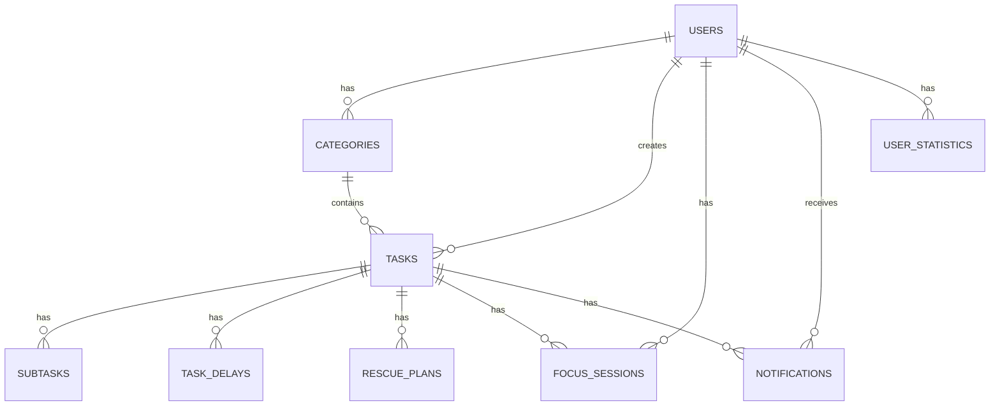

# Anti-Procrastination App - Database ERD

## Tables

The Anti-Procrastination App database consists of:

1. users
2. categories
3. tasks
4. subtasks
5. task_delays
6. rescue_plans
7. focus_sessions
8. notifications
9. user_statistics

## Entity Relationships

## Relationship Description

### User - Category

One user can have many categories.

### User - Task

One user can have many tasks.

### Category - Task

One category can contain many tasks.

### Task - Subtask

One task can have many subtasks.

### Task - Task Delay

One task can have multiple delay histories.

### Task - Rescue Plan

One task can have multiple rescue plans.

### Task - Focus Session

One task can have multiple focus sessions.

### User - Focus Session

One user can have multiple focus sessions.

### Task - Notification

One task can generate multiple notifications.

### User - Notification

One user can receive multiple notifications.

### User - User Statistic

One user can have multiple daily statistic records.
