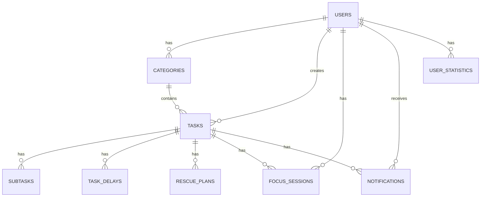
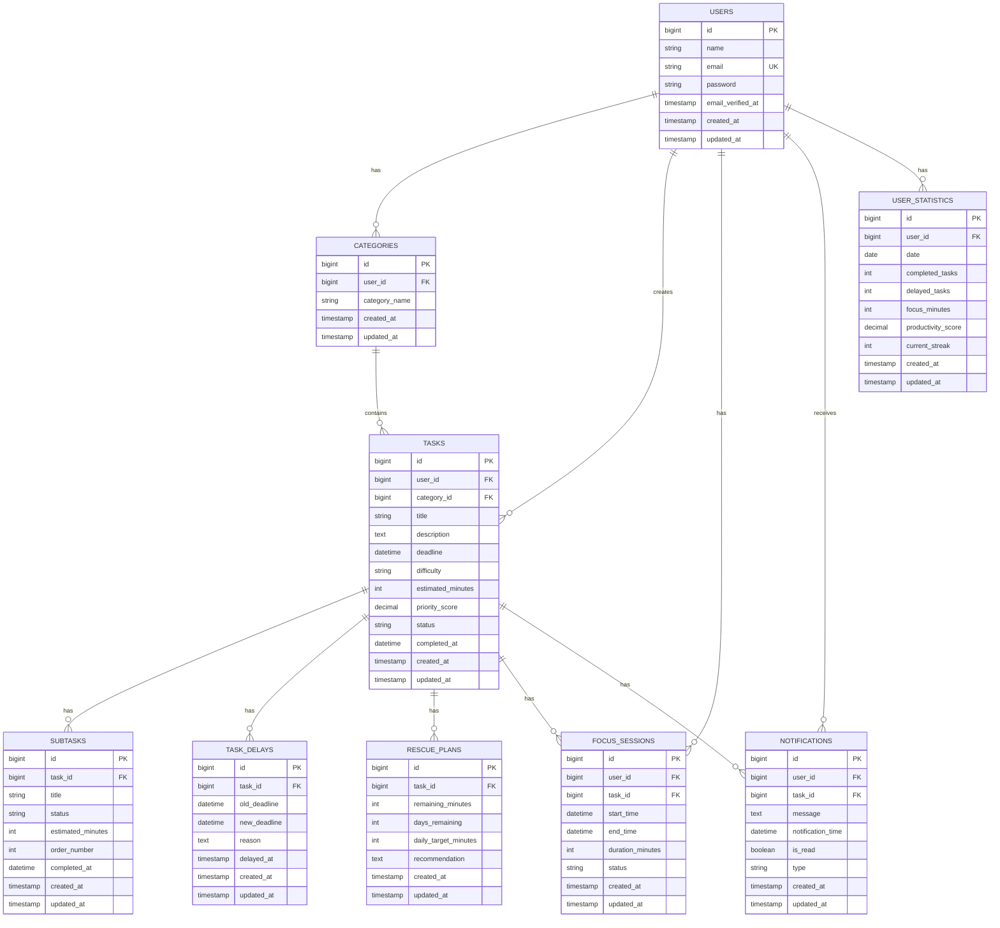

# Database Design — Anti-Procrastination App

This document contains the Entity Relationship (ER) and Entity Relationship Diagram (ERD) for the Anti-Procrastination App.

## 1. Entity Relationship (ER)

The ER below shows the main relationships between entities without displaying all attributes.

## 2. Entity Relationship Diagram (ERD)

The ERD below shows the entities, attributes, primary keys, foreign keys, and relationships.

## 3. Relationship Summary

| Relationship | Type |
| --- | --- |
| User → Category | One-to-Many |
| User → Task | One-to-Many |
| Category → Task | One-to-Many |
| Task → Subtask | One-to-Many |
| Task → TaskDelay | One-to-Many |
| Task → RescuePlan | One-to-Many |
| User → FocusSession | One-to-Many |
| Task → FocusSession | One-to-Many |
| User → Notification | One-to-Many |
| Task → Notification | One-to-Many |
| User → UserStatistic | One-to-Many |

## 4. Design Notes

- `users.email` is unique.
- Each category belongs to one user.
- Each task belongs to one user.
- A task may belong to one category.
- Each subtask belongs to one task.
- Each task delay belongs to one task.
- Each rescue plan belongs to one task.
- Focus sessions belong to a user and may be associated with a task.
- Notifications belong to a user and may be associated with a task.
- Each user can have one statistic record per date.
